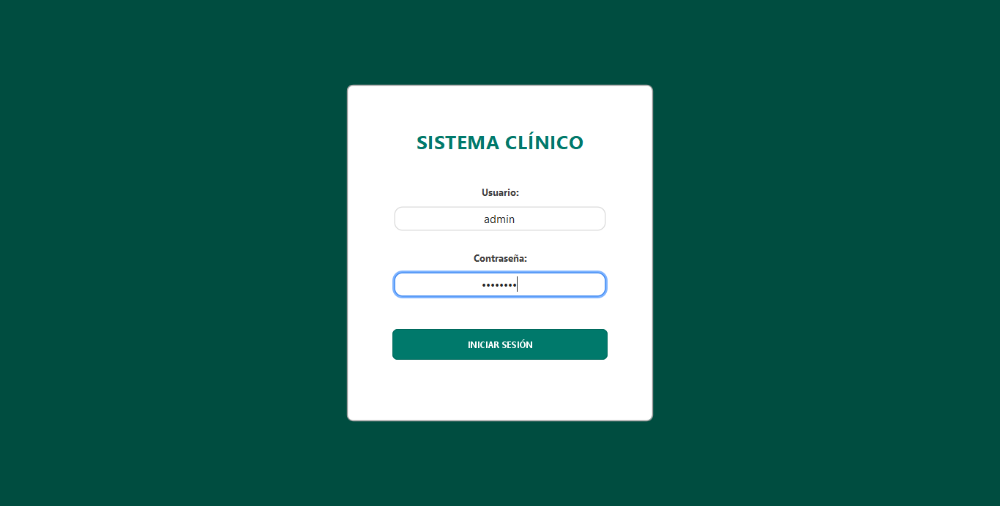
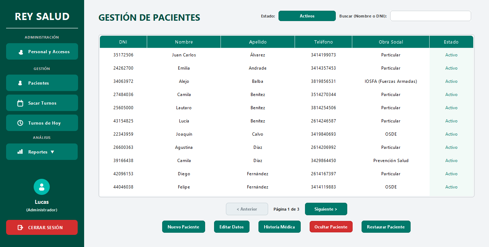
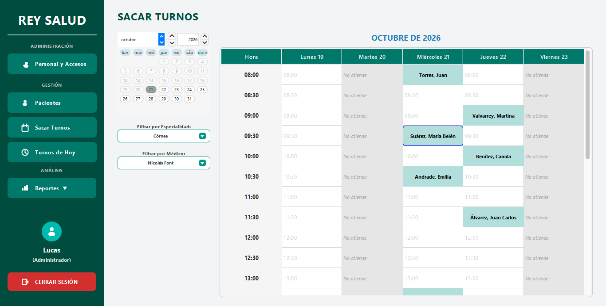
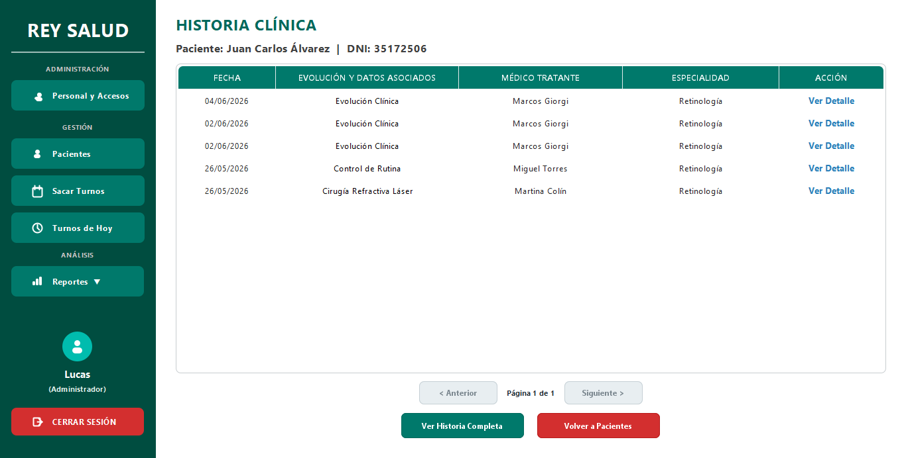
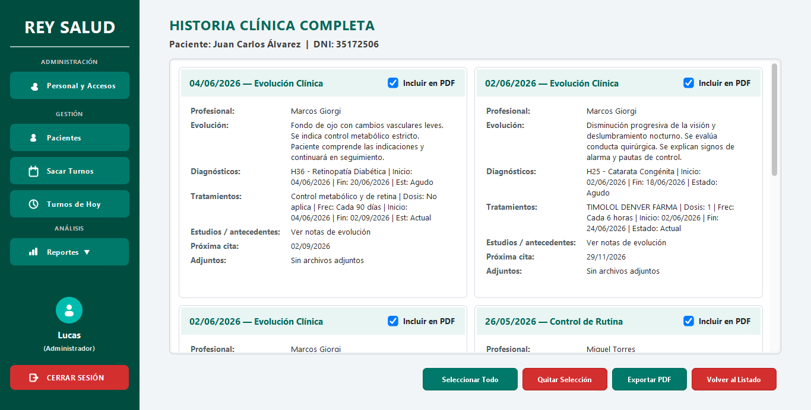
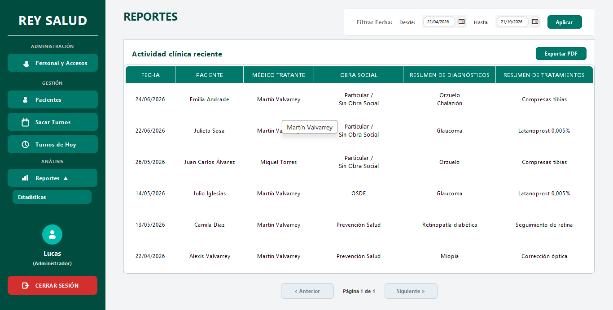

# ReySalud — Sistema de gestión clínica

App de escritorio para una clínica: pacientes, personal, turnos, historias clínicas, reportes y estadísticas.
Proyecto final de **Programación II** (Tecnicatura Superior en Desarrollo de Software), hecho en equipo y defendido en 2026.

**Stack:** Java 17 · Swing (FlatLaf) · PostgreSQL · JDBC · iText (PDF) · NetBeans/Ant

## Qué hace

| Módulo | Detalle |
|---|---|
| **Login y roles** | Administrador, Médico y Secretaría. El menú y los permisos cambian según el rol, y la navegación valida el rol aunque se intente abrir una pantalla por otro camino |
| **Pacientes** | Alta, búsqueda, paginación y edición, con obra social y número de afiliado coherentes |
| **Personal y usuarios** | Especialidades, matrículas, horarios de atención y accesos |
| **Turnos** | Calendario semanal en bloques de 30 min que respeta horarios, feriados y especialidad. Estados: Reservado → Esperando → En Consulta → Atendido / Cancelado / Ausente / Finalizado |
| **Historia clínica** | Evolución por turno con diagnósticos y medicamentos filtrados por especialidad, más adjuntos |
| **Reportes** | Actividad clínica e historia clínica a PDF; turnos y estadísticas a XLSX |

## Capturas

Todas con la base de ejemplo (datos inventados).

| | |
|---|---|
| **Inicio de sesión** (roles: Administrador, Médico, Secretaría) | **Pacientes**: búsqueda, paginación y alta/edición |
|  |  |
| **Turnos**: calendario semanal por especialidad y médico | **Historia clínica** de un paciente |
|  |  |
| **Historia clínica completa**: elegir qué evoluciones exportar | **Reportes**: actividad clínica filtrada por fecha |
|  |  |

El reporte exportado a PDF: [ver captura](docs/capturas/reporte_pdf.png).

## Decisiones técnicas destacadas

- **Reglas críticas en tres capas.** Un turno Atendido es definitivo: lo bloquea la interfaz, lo valida el DAO y lo impide un **trigger de PostgreSQL**. Aunque alguien saltee la app, la base no lo deja.
- **Reserva concurrente segura.** No puede haber dos turnos activos para el mismo médico u horario, ni para el mismo paciente u horario. Se garantiza con transacciones y restricciones `UNIQUE`, no solo con un `if` en Java.
- **Contraseñas con PBKDF2** (210.000 iteraciones, sal aleatoria por usuario, comparación en tiempo constante). Las claves heredadas se migraron al formato protegido.
- **Patrón DAO.** Las pantallas no escriben SQL: se separa la interfaz del acceso a datos.
- **Migraciones versionadas** (`database/migration_AAAA_MM_DD_*.sql`): cada cambio de la estructura de la base queda fechado y se puede reproducir.
- **Operación real.** Varias PCs contra una sola base PostgreSQL, configuradas por variables de entorno (sin claves en el código), y scripts de backup y restauración.

## Documentación

- [Informe del proyecto](docs/Informe_Practica_Profesional_II.pdf) (Práctica Profesionalizante II, prof. Jorge A. Perusini): situación actual, objetivos, alcance, requisitos y especificación de casos de uso. Versión editable en [.docx](docs/Informe_Practica_Profesional_II.docx).
- [Requerimientos y validación final](docs/Requerimientos_ReySalud.pdf): funcionales, no funcionales, matriz de trazabilidad y auditoría.
- [Diagrama de casos de uso](docs/diagramas/Diagrama_Casos_de_Uso_ReySalud_Actualizado.png)
- [Diagrama de clases](docs/diagramas/Diagrama_de_Clases_ReySalud_Actualizado.png)
- [Operación y respaldo](database/OPERACION_Y_RESPALDO.md)

## Cómo correrlo

1. Instalar **Java 17+** y **PostgreSQL**.
2. Crear una base y cargar los datos de ejemplo:
   ```bash
   createdb reysalud
   psql -d reysalud -f database/clinica2_docker.sql
   ```
3. Configurar la conexión con variables de entorno: `REYSALUD_DB_HOST`, `REYSALUD_DB_PORT`, `REYSALUD_DB_NAME`, `REYSALUD_DB_USER`, `REYSALUD_DB_PASSWORD`, `REYSALUD_DB_SCHEMA`.
4. Abrir el proyecto en **NetBeans** y ejecutar `ClinicaBalbarrey` (o compilar con Ant: `ant run`).
5. Ingresar con el usuario `admin` y la contraseña `demo1234`. Todos los usuarios de ejemplo usan esa contraseña.

> Los datos de la base de ejemplo son **inventados**: no hay datos reales de pacientes ni del personal.

## Equipo

- **Alexis Balbarrey**
- **Lucas Bonadeo**
- **Juan Francisco Ingaramo**

Repositorio de trabajo original: privado. Esta es una copia pública para portafolio, con datos de ejemplo y sin historial.
